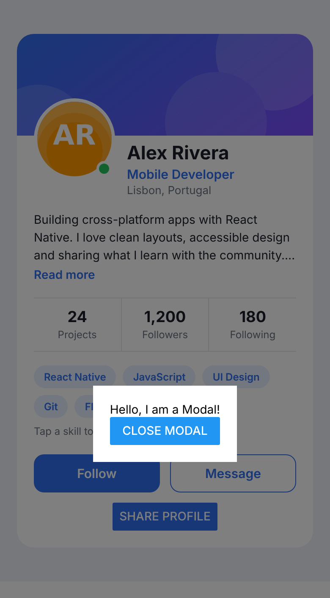
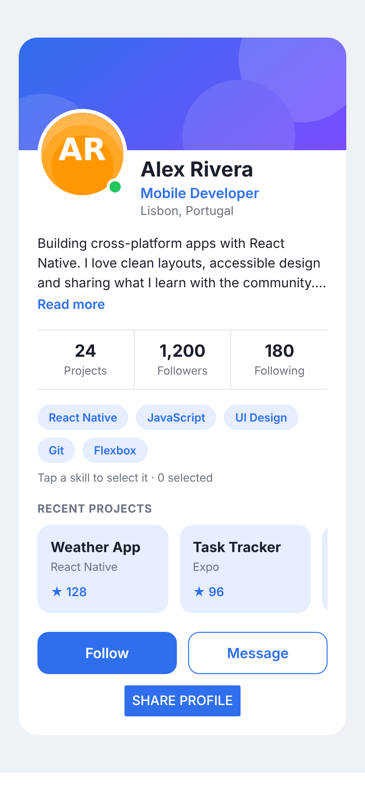
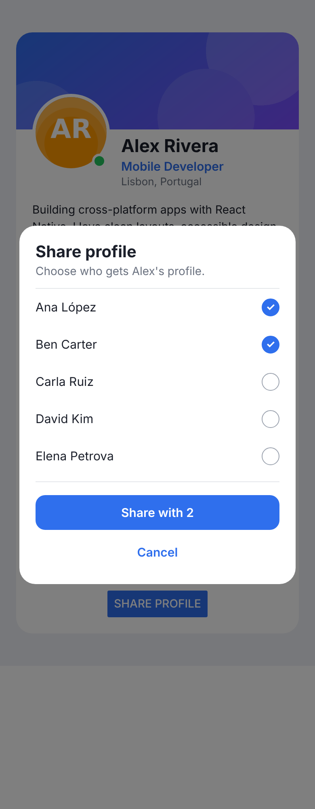
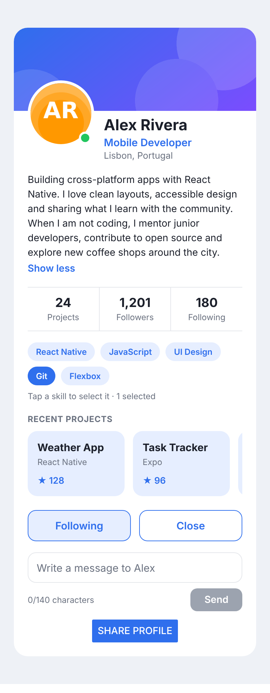

# Guía del profesor — Tarea práctica 3: Modals, ScrollView y SafeAreaView

**Tema:** Modals, `ScrollView` y `SafeAreaView` en Expo
**Duración:** 60 minutos de trabajo del estudiante + 10 minutos de revisión (opcional)
**Material para estudiantes:** carpeta [`../student/`](../student/)
**Requisitos previos:** [Tarea 1](../../task-1/) (layout y estilos) y [Tarea 2](../../task-2/) (eventos y estado)

> ⚠️ Esta carpeta contiene la solución. Si los estudiantes tienen acceso al repositorio, publica `teacher/` en un repositorio **privado** o en una rama privada.

## 1. Contenido de esta carpeta

| Archivo | Para qué sirve |
|---|---|
| `solution/App.js` | Solución final (idéntica a `steps/step-5.js`) |
| `solution/steps/step-1.js` … `step-5.js` | Una versión **completa y ejecutable** de `App.js` por cada paso (para *live coding* o para comparar) |
| `solution/assets/` | Imágenes (`avatar.png`, `banner.png`) |
| `screenshots/` | Captura del resultado al terminar cada paso |

`student/` y `teacher/solution/` son **proyectos Expo completos** (`package.json`, `app.json`, `index.js`; Expo SDK 58). Esta tarea añade la dependencia `react-native-safe-area-context` (`~5.10.1`, la versión que Expo SDK 58 recomienda), que se instala con `npm install`. Para probar la solución: `cd teacher/solution`, `npm install`, `npx expo start`. Para ver un paso, copia `steps/step-N.js` sobre `App.js`.

> **Cómo se verificó:** el comportamiento (abrir/cerrar el modal, tocar el fondo, scroll horizontal y vertical, selección de contactos, alertas, reinicio de la selección) se probó con `react-native-web` y pruebas automáticas en un navegador, y todos los pasos compilan para Android con `expo export`. Las capturas salen de la versión web. **Prueba la solución en un teléfono o emulador antes de la clase**: el botón *atrás* de Android, el teclado, `Alert` y el *notch* solo se comprueban en un dispositivo real.

## 2. Qué se añade respecto a las Tareas 1 y 2

La pantalla es la misma *profile card*. Lo nuevo:

| Elemento | Tarea 2 | Tarea 3 |
|---|---|---|
| Botón *Share profile* | Muestra un `Alert` | Abre un `Modal` |
| Modal | no existe | Estado `modalVisible`, diseño propio, se cierra de 4 formas |
| Lista de proyectos | no existe | `ScrollView` **horizontal** con `PROJECTS` |
| Lista de contactos | no existe | `ScrollView` **vertical** dentro del modal, con `CONTACTS` |
| Selección de contactos | — | Array en estado (inmutable), valor derivado `isShareDisabled` |
| Raíz de la pantalla | `ScrollView` | `SafeAreaView` > `ScrollView` |

Se **reutilizan** conceptos anteriores: `useState`, arrays inmutables (Tarea 2), `Pressable` con `pressed` (Tarea 2) y `StyleSheet`/Flexbox (Tarea 1).

## 3. Objetivos de aprendizaje

1. Mostrar/ocultar un `Modal` con la prop `visible` controlada por estado.
2. Cerrarlo de todas las formas esperadas: botón, toque en el fondo y botón *atrás* de Android (`onRequestClose`).
3. Elegir `animationType` y `transparent` y construir un diseño propio (overlay + tarjeta).
4. Usar `ScrollView` vertical y `horizontal`; distinguir `style` de `contentContainerStyle`.
5. Usar `SafeAreaView` para respetar la zona segura del dispositivo.
6. Aplicar las buenas prácticas de la presentación: modales con moderación, limitar el contenido del `ScrollView`, usar siempre `SafeAreaView`.

## 4. Preparación (antes de la clase)

- Node.js (LTS), VS Code y Expo Go (SDK 58) en cada teléfono; teléfono y computadora en la **misma Wi-Fi** (si no, `npx expo start --tunnel`).
- Probar `npm install` y `npx expo start` en `student/` (descarga una dependencia nueva respecto a la Tarea 2).
- Recordar que `Alert.alert` **no funciona en la versión web**; los estudiantes deben usar Expo Go o un emulador.
- Los estudiantes reciben todos los estilos nuevos en un bloque del README (paso 2). El objetivo es entender `Modal`, `ScrollView` y `SafeAreaView`, no escribir CSS.

## 5. Plan de tiempo sugerido

| Minutos | Actividad |
|---|---|
| 0–5 | Mostrar `student/expected-result-1.png` y `expected-result-2.png`; repasar qué se hizo en las Tareas 1 y 2 |
| 5–15 | Paso 1: primer `Modal` (el de la presentación) |
| 15–25 | Paso 2: diseño propio y formas de cerrar |
| 25–35 | Paso 3: `ScrollView` horizontal |
| 35–50 | Paso 4: `ScrollView` vertical dentro del modal + selección |
| 50–60 | Paso 5: `SafeAreaView` y buenas prácticas |
| 60–70 | Revisión y preguntas de comprobación |

Si el grupo va lento, el paso 4 se puede acortar: pedir solo la lista y la selección, y dar el botón *Share* ya hecho.

## 6. Paso a paso con explicación

### Paso 1 — Primer `Modal` (`step-1.js`)



**Qué se construye:** el modal exacto de la presentación, abierto desde el botón *Share profile*.

```jsx
import { ..., Alert, Modal, ... } from 'react-native';

const [modalVisible, setModalVisible] = useState(false);

<Button title="Share profile" color={COLORS.primary} onPress={() => setModalVisible(true)} />

<Modal
  animationType="slide"
  transparent={true}
  visible={modalVisible}
  onRequestClose={() => {
    Alert.alert('Modal has been closed.');
  }}>
  <View style={{ flex: 1, justifyContent: 'center', alignItems: 'center', backgroundColor: 'rgba(0, 0, 0, 0.5)' }}>
    <View style={{ backgroundColor: 'white', padding: 20 }}>
      <Text>Hello, I am a Modal!</Text>
      <Button title="Close Modal" onPress={() => setModalVisible(!modalVisible)} />
    </View>
  </View>
</Modal>
```

**Qué explicar:**
- Un **modal** es una capa que se muestra encima de la pantalla actual sin interrumpir el flujo de la app (la pantalla de abajo conserva su estado).
- `visible` decide si se ve: `true` o `false`. Como cambia con las acciones del usuario, **debe ser estado** (`useState`). El `Modal` no se abre solo.
- `transparent={true}`: sin esto el modal tapa todo con un fondo sólido. Con transparencia, el `View` exterior con `rgba(0, 0, 0, 0.5)` crea el efecto de pantalla oscurecida.
- `animationType`: `"slide"` (desliza desde abajo), `"fade"` (se desvanece) o `"none"`.
- El `View` exterior usa `flex: 1` + `justifyContent` + `alignItems: 'center'` (Flexbox de la Tarea 1) para centrar la tarjeta.
- El botón que abre debe usar una **función flecha**: `onPress={() => setModalVisible(true)}`. Con `onPress={setModalVisible(true)}` el modal se abriría al iniciar la app (mismo error de `onPress={fn()}` de la Tarea 2).
- **Detalle importante:** en este código, `onRequestClose` solo muestra una alerta y **no cierra** el modal. En Android, al pulsar *atrás* el usuario queda atrapado. Se corrige en el paso 2. Es un buen momento para pedir que lo prueben.
- `setModalVisible(!modalVisible)` funciona porque ese botón solo se ve con el modal abierto. Es más claro escribir `setModalVisible(false)`.

### Paso 2 — Diseño propio y formas de cerrar (`step-2.js`)


```jsx
const closeModal = () => {
  setModalVisible(false);
};

<Modal animationType="fade" transparent={true} visible={modalVisible} onRequestClose={closeModal}>
  <View style={styles.overlay}>
    <Pressable style={StyleSheet.absoluteFill} onPress={closeModal} />
    <View style={styles.sheet}>
      <Text style={styles.sheetTitle}>Share profile</Text>
      <Text style={styles.sheetText}>Share Alex's profile with your team.</Text>
      <Pressable onPress={closeModal} style={({ pressed }) => [styles.sheetClose, pressed && styles.pressed]}>
        <Text style={styles.sheetCloseText}>Close</Text>
      </Pressable>
    </View>
  </View>
</Modal>
```

**Qué explicar:**
- Los estilos en línea de la presentación se pasan a `StyleSheet` (buena práctica de la Tarea 1) y se usa la paleta `COLORS`.
- **Cuatro formas de cerrar:** botón *Close*, botón *Cancel* (paso 4), toque en el fondo oscuro y botón *atrás* de Android (`onRequestClose`). Un buen modal permite las cuatro.
- **Toque en el fondo:** se añade un `Pressable` con `StyleSheet.absoluteFill` (equivale a `position: 'absolute'` + `top/left/right/bottom: 0`, de la Tarea 1) **antes** de la tarjeta. La tarjeta se dibuja encima, así que tocar dentro de ella **no** cierra el modal; tocar fuera sí.
- Error típico: poner el `onPress` en el `View` exterior que contiene la tarjeta: cualquier toque dentro de la tarjeta "sube" al padre y cierra el modal.
- `maxWidth: 420` y `width: '100%'` en la tarjeta hacen que se vea bien en teléfonos y tabletas.
- `onRequestClose` es **obligatorio en Android** (la documentación lo exige); en iOS se usa en iPad con ciertos gestos.

### Paso 3 — `ScrollView` horizontal (`step-3.js`)



```jsx
<Text style={styles.sectionTitle}>RECENT PROJECTS</Text>
<ScrollView
  horizontal
  showsHorizontalScrollIndicator={false}
  contentContainerStyle={styles.projectsRow}
>
  {PROJECTS.map((project) => (
    <View key={project.name} style={styles.projectCard}>
      <Text style={styles.projectName}>{project.name}</Text>
      <Text style={styles.projectTech}>{project.tech}</Text>
      <Text style={styles.projectStars}>★ {project.stars}</Text>
    </View>
  ))}
</ScrollView>
```

**Qué explicar:**
- `ScrollView` permite **desplazar** contenido que no cabe. Un `View` normal **no** hace scroll: lo que no cabe se corta. (La raíz de la pantalla ya es un `ScrollView` desde la Tarea 2.)
- `horizontal` cambia la dirección del scroll. Por defecto es vertical.
- **`style` vs `contentContainerStyle`:** `style` es el estilo del propio `ScrollView` (su caja visible). `contentContainerStyle` es el estilo del contenedor interno que **envuelve a los hijos**: aquí `gap` separa las tarjetas y en la pantalla raíz centra y rellena. Poner `gap` en `style` no tendría efecto sobre los hijos.
- Cada tarjeta tiene ancho fijo (140); si no, se encogerían para caber y no habría scroll.
- Un `ScrollView` horizontal dentro de uno vertical funciona sin problema porque las direcciones son distintas.
- `showsHorizontalScrollIndicator={false}` oculta la barra (estético).
- El `ScrollView` **renderiza todos sus hijos de una vez**. Con 5 proyectos está bien; con cientos se usa `FlatList` (renderiza solo lo visible).
- Recordar el ejemplo de la presentación: varios `Text` de 96 puntos dentro de un `ScrollView` para ver el scroll vertical en acción.

### Paso 4 — `ScrollView` dentro del modal (`step-4.js`)



```jsx
const [selectedContacts, setSelectedContacts] = useState([]);
const isShareDisabled = selectedContacts.length === 0;

const closeModal = () => {
  setModalVisible(false);
  setSelectedContacts([]);
};

const handleContactPress = (name) => {
  setSelectedContacts(
    selectedContacts.includes(name)
      ? selectedContacts.filter((item) => item !== name)
      : [...selectedContacts, name]
  );
};

const handleConfirmShare = () => {
  Alert.alert('Profile shared', `Sent to: ${selectedContacts.join(', ')}`);
  closeModal();
};

<ScrollView style={styles.contactList}>
  {CONTACTS.map((name) => {
    const isSelected = selectedContacts.includes(name);
    return (
      <Pressable key={name} onPress={() => handleContactPress(name)} style={...}>
        <Text style={styles.contactName}>{name}</Text>
        <View style={[styles.checkbox, isSelected && styles.checkboxSelected]}>
          {isSelected && <Text style={styles.checkMark}>✓</Text>}
        </View>
      </Pressable>
    );
  })}
</ScrollView>

<Pressable disabled={isShareDisabled} onPress={handleConfirmShare} style={...}>
  <Text style={styles.shareButtonText}>
    {isShareDisabled ? 'Select contacts' : `Share with ${selectedContacts.length}`}
  </Text>
</Pressable>
```

**Qué explicar:**
- Aquí el `ScrollView` es **vertical** y tiene `maxHeight: 240` en su `style`. Sin una altura limitada, el `ScrollView` crece hasta mostrar todo y **nunca hace scroll**. Esa es la clave: el `ScrollView` solo hace scroll cuando su contenido es más grande que su caja.
- Los 8 contactos no caben en 240, así que aparece el scroll dentro del modal sin que el modal se salga de la pantalla.
- La selección usa el **patrón de la Tarea 2**: array en estado, actualizado con `filter` y spread. Si usan `push`, la selección no se actualiza.
- `isShareDisabled` es un **valor derivado** (no un segundo estado), igual que `isSendDisabled` en la Tarea 2.
- `closeModal` también limpia la selección: así, se cierre como se cierre (botón, fondo o *atrás*), el modal se abre siempre "limpio". Pregunta: ¿qué pasa si solo se limpia en `handleConfirmShare`? (Al cancelar, la selección quedaría guardada.)
- Se muestra el `Alert` **antes** de `closeModal()` porque `closeModal` limpia el array y el mensaje ya se construyó; el orden importa si se usara el array después.

### Paso 5 — `SafeAreaView` y buenas prácticas (`step-5.js`, solución final)



```jsx
import { SafeAreaView } from 'react-native-safe-area-context';

return (
  <SafeAreaView style={styles.safe}>
    <ScrollView style={styles.screen} contentContainerStyle={styles.screenContent} keyboardShouldPersistTaps="handled">
      ...
      <Modal ...>...</Modal>
    </ScrollView>
  </SafeAreaView>
);
```
```js
safe: { flex: 1, backgroundColor: COLORS.background },
```

**Qué explicar:**
- **Zona segura (*safe area*):** el área donde el contenido no se solapa con el *notch* o la isla dinámica, la barra de estado, las esquinas redondeadas ni la barra de gestos. `SafeAreaView` añade el espacio necesario en esos bordes.
- Ejemplo de la presentación: `<SafeAreaView style={{ flex: 1 }}>`. Sin `flex: 1` solo mediría lo que necesita su contenido.
- **Por qué `react-native-safe-area-context`:** el `SafeAreaView` incluido en `react-native` solo funcionaba en iOS y, según la documentación de React Native, está marcado como obsoleto (*deprecated*) en las versiones recientes. La librería funciona en iOS y Android y es la que recomienda Expo. Si algún estudiante importa `SafeAreaView` desde `react-native` (como en la presentación), verá un aviso o no habrá efecto en Android: es un buen momento para explicarlo.
- `backgroundColor` en `safe`: sin color, las franjas de la zona segura mostrarían otro fondo; el color de la pantalla debe extenderse hasta los bordes.
- Se puede elegir qué bordes proteger con `edges`, por ejemplo `edges={['top', 'bottom']}`.
- En la versión web de prueba no se nota (no hay *notch*): probar en un teléfono.

**Buenas prácticas de la presentación (resumen para la clase):**
1. **Usar modales con moderación:** interrumpen al usuario. Sirven para decisiones rápidas y acciones cortas (confirmar, compartir). No para flujos largos ni contenido principal.
2. **Optimizar el `ScrollView` limitando el contenido renderizado:** pocos elementos (aquí 5 y 8); para listas largas, `FlatList`.
3. **Usar siempre `SafeAreaView`** en la raíz de cada pantalla para que la app se vea bien en todos los dispositivos.

## 7. Respuestas a las preguntas de comprobación

1. **`visible`** — Decide si el modal se muestra (`true`) o se oculta (`false`). Se controla con `useState` porque cambia con las acciones del usuario y React debe volver a dibujar la pantalla cuando cambia; el `Modal` no se abre ni se cierra por sí solo.
2. **`onRequestClose`** — Es la función que se ejecuta cuando el sistema pide cerrar el modal (botón *atrás* de Android). Si no cierra el modal ahí (por ejemplo, si solo muestra un `Alert`), el usuario no puede salir con el botón *atrás*. En Android la prop es obligatoria.
3. **`transparent` y `animationType`** — `transparent={true}` hace que el fondo del modal sea transparente y deja ver la pantalla de atrás (necesario para el efecto de pantalla oscurecida); sin ella, el modal tapa todo con un fondo sólido. Valores de `animationType`: `"none"`, `"slide"` y `"fade"`.
4. **`ScrollView`** — Permite desplazar contenido que no cabe en la pantalla. Una `View` larga sin él se corta y el resto es inaccesible. Se usa `FlatList` cuando la lista es larga, porque `ScrollView` renderiza todos los hijos a la vez y `FlatList` solo los visibles (mejor rendimiento y memoria).
5. **`style` vs `contentContainerStyle`** — `style` da estilo al propio `ScrollView` (su caja: tamaño, fondo, `maxHeight`). `contentContainerStyle` da estilo al contenedor interno que envuelve a los hijos (padding, `gap`, `justifyContent`, etc.).
6. **`SafeAreaView`** — Mantiene el contenido dentro de la zona segura: evita el solapamiento con el *notch* o isla dinámica, la barra de estado, las esquinas redondeadas y la barra de gestos. Se usa `react-native-safe-area-context` porque funciona en iOS **y** Android; el componente incluido en React Native solo cubría iOS y está obsoleto en versiones recientes.
7. **Buenas prácticas** — (a) Modales con moderación, porque interrumpen; (b) limitar el contenido que renderiza un `ScrollView` (y usar `FlatList` para listas largas); (c) usar siempre `SafeAreaView`. Ejemplos de cuándo un modal **no** conviene: un formulario largo de varios pasos (mejor una pantalla propia), mostrar el contenido principal de la app, mostrar varios modales apilados, o avisos que se repiten constantemente.

## 8. Rúbrica (100 puntos + 10 de bonus)

| Criterio | Puntos |
|---|---|
| Paso 1: `Modal` con `visible`, estado y botón que lo abre (con función flecha) | 15 |
| Paso 2: diseño con `StyleSheet`, se cierra por botón, fondo y `onRequestClose` | 20 |
| Paso 3: `ScrollView` horizontal con `.map()`, `key` y `contentContainerStyle` | 15 |
| Paso 4: lista con scroll dentro del modal, selección **inmutable**, botón deshabilitado, reinicio al cerrar | 20 |
| Paso 5: `SafeAreaView` desde `react-native-safe-area-context` en la raíz | 10 |
| Calidad: sin estilos en línea en la versión final, sin warnings, Tareas 1 y 2 siguen funcionando | 5 |
| `ANSWERS.md` (7 preguntas) | 10 |
| Git: rama, commits por paso y Pull Request con captura | 5 |
| **Bonus** (buscador de contactos, opción extra en el modal, `useSafeAreaInsets`) | +10 |

## 9. Errores comunes

| Síntoma | Causa | Cómo ayudar |
|---|---|---|
| El modal se abre al iniciar la app | `onPress={setModalVisible(true)}` (se ejecuta al renderizar) | Usar `() => setModalVisible(true)` |
| El modal no aparece | `visible` nunca es `true`, o falta importar `Modal` | Revisar el estado y el `import` |
| Al abrir solo se ve una pantalla blanca | Falta `transparent={true}` | Añadirla |
| En Android el botón *atrás* no cierra el modal | `onRequestClose` solo muestra un `Alert` o no existe | Usar `onRequestClose={closeModal}` |
| Tocar dentro de la tarjeta cierra el modal | El `onPress` de cerrar está en el contenedor que envuelve la tarjeta | Usar un `Pressable` con `StyleSheet.absoluteFill` **detrás** de la tarjeta |
| Tocar fuera de la tarjeta no cierra el modal | El `Pressable` del fondo va **después** de la tarjeta (queda encima) o no tiene `absoluteFill` | Ponerlo antes de la tarjeta |
| La lista del modal no hace scroll | El `ScrollView` no tiene altura limitada (`maxHeight`/`height`) | Añadir `maxHeight` en su `style` |
| El scroll horizontal no aparece | Falta `horizontal`, o las tarjetas no tienen ancho fijo | Añadir `horizontal` y `width` a las tarjetas |
| `gap` entre tarjetas no se aplica | Está en `style` en lugar de `contentContainerStyle` | Moverlo a `contentContainerStyle` |
| La selección de contactos no se actualiza | `selectedContacts.push(name)` (mutación) | Usar `[...selectedContacts, name]` / `filter` |
| Al reabrir el modal sigue la selección anterior | `closeModal` no limpia `selectedContacts` | Añadir `setSelectedContacts([])` |
| `Unable to resolve react-native-safe-area-context` | No se ejecutó `npm install` | `npm install` y reiniciar `npx expo start` |
| El contenido queda bajo el *notch* | Falta `SafeAreaView`, o se importó de `react-native` en Android | Usar el de `react-native-safe-area-context` |
| `Alert` no hace nada | Se prueba en la web | Usar Expo Go o un emulador |
| `npm error enoent ... package.json` | Terminal en la carpeta equivocada | `cd` a la carpeta con `package.json` |

## 10. Preguntas para abrir la discusión (final de la clase)

- ¿Qué cambiaría si usaras un `Modal` para mostrar el contenido principal de la app? ¿Y un modal dentro de otro modal?
- ¿Qué pasa si pones 1 000 contactos dentro del `ScrollView`? ¿Qué componente usarías? (`FlatList`.)
- ¿Por qué el mismo estado (`modalVisible`) sirve para abrir y para cerrar el modal desde dos botones distintos?
- ¿En qué se parece el patrón *evento → setter → nuevo render* del modal al del botón *Follow* de la Tarea 2?
